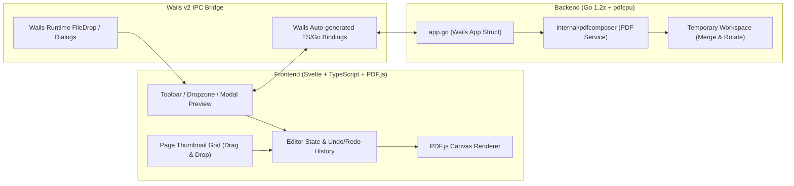

# PdfPageComposer 実装計画書

## Goal Description

[RequestDraft.txt](file:///home/ftoy/Work/PdfPageComposer/RequestDraft.txt) およびヒアリング結果に基づき、**Wails v2 + Go (`pdfcpu`) + Svelte (TypeScript + `pdfjs-dist`)** を用いたクロスプラットフォーム（Linux / Windows）対応のPDFページ編集デスクトップアプリ **PdfPageComposer** を構築します。

### 主な機能要件
1. **PDFファイルの読み込み・挿入**
   - ネイティブファイル選択ダイアログおよびウィンドウへのドラッグ＆ドロップ（Wails `OnFileDrop`）による複数PDFの読み込み
   - 末尾への追加だけでなく、指定位置（選択ページの前／後、またはカード間の挿入ポイント）への別PDF挿入
2. **ページサムネイル一覧と拡大プレビュー**
   - `pdfjs-dist` による高速・軽量なページサムネイルグリッド描画（CGo不要）
   - ページクリック（または拡大ボタン）による高解像度モーダルプレビュー表示（前後ページ移動・ズーム・回転操作対応）
3. **ページ編集操作**
   - ドラッグ＆ドロップによる直感的なページ順変更（単一ページおよび複数選択ページの一括移動）
   - 単一・複数ページ選択（クリック、`Ctrl`/`Cmd`+クリック、`Shift`+クリック、全選択／選択解除）
   - 選択ページの削除（ボタンおよび `Delete` / `Backspace` キー）
   - ページの90度単位回転（左90度・右90度、プレビューへの即時反映＋出力PDFへの反映）
   - 操作履歴の Undo / Redo（`Ctrl+Z` / `Ctrl+Y`・`Ctrl+Shift+Z` およびツールバーボタン）
4. **PDF出力（エクスポート）**
   - ネイティブ保存ダイアログで出力先を指定し、Goバックエンドの `pdfcpu` で元のPDFのベクター品質を維持したまま結合・ページ抽出・回転・並び替えを行って単一PDFとして出力
5. **ドキュメント整備・コーディング規約**
   - コード作成前に `AGENTS.md`、`SpecSummary20261106.txt`、および `docs/` 配下の設計仕様書を作成
   - Go / TypeScript ともに **Google Style Guide** に準拠

---

## システムアーキテクチャ



> [!NOTE]
> **プレビュー用のPDFバイナリ受け渡し方式**
> フロントエンドの `pdfjs-dist` がローカルPDFを描画するため、Goバックエンドで読み込んだソースPDFをメモリキャッシュ（またはBase64 / Wails AssetHandler経由のローカルストリーム）としてフロントエンドへ供給します。巨大なPDFでもIPCが詰まらないよう、Wailsの `AssetServer.Handler` を拡張した `/local-pdf/{sourceId}` エンドポイント経由で `Uint8Array` / Range リクエストとして `pdfjs-dist` に渡す設計とします。

---

## Proposed Changes

実装はプロジェクトルール（`.agents/rules/basic_philosophy.md`）および `RequestDraft.txt` に従い、以下の4フェーズで段階的に進めます。

---

### Phase 1: ドキュメント・仕様書の作成（コード作成前）

#### [NEW] [AGENTS.md](file:///home/ftoy/Work/PdfPageComposer/AGENTS.md)
- プロジェクト概要、ディレクトリ構成、技術スタック（Wails v2, Go, Svelte + TS, Bun）
- Google Go Style Guide / Google TypeScript Style Guide の具体的な適用ルール
- ビルド・テスト・依存管理コマンド（`dep-version-management` スキル準拠で `frontend/bun.lock` と `go.sum` を管理）

#### [NEW] [SpecSummary20261106.txt](file:///home/ftoy/Work/PdfPageComposer/SpecSummary20261106.txt)
- プロジェクトの目的、ターゲットOS（Linux / Windows）、機能スコープ、非機能要件（CGoフリー、レスポンシブなUI、ロスレスPDF結合）を定義した最上位仕様概要書

#### [NEW] [docs/architecture.md](file:///home/ftoy/Work/PdfPageComposer/docs/architecture.md)
- フロントエンド・バックエンド間のデータフロー、Wails AssetServer によるPDFバイナリ配信、エラーハンドリング方針

#### [NEW] [docs/backend_pdf_service.md](file:///home/ftoy/Work/PdfPageComposer/docs/backend_pdf_service.md)
- `internal/pdfcomposer` パッケージのインターフェース定義、`pdfcpu` を使ったページ抽出・結合・回転アルゴリズムと一時ファイル管理

#### [NEW] [docs/frontend_ui_state.md](file:///home/ftoy/Work/PdfPageComposer/docs/frontend_ui_state.md)
- ページアイテムの型定義、複数選択ロジック、Undo/Redo ヒストリースタック、ドラッグ＆ドロップ挿入仕様

---

### Phase 2: Wails プロジェクト初期化と Go バックエンド実装

#### [NEW] [wails.json](file:///home/ftoy/Work/PdfPageComposer/wails.json) / [go.mod](file:///home/ftoy/Work/PdfPageComposer/go.mod) / [main.go](file:///home/ftoy/Work/PdfPageComposer/main.go)
- Wails v2 (`svelte-ts`) 構成の初期化（フロントエンドのビルド・パッケージマネージャに `bun` を設定）
- `OnFileDrop` の有効化、および `/local-pdf/{sourceId}` を配信するカスタム `http.Handler` の登録

#### [NEW] [app.go](file:///home/ftoy/Work/PdfPageComposer/app.go)
- フロントエンドに公開する Wails バインディングメソッドを定義：
  ```go
  // SelectPDFs opens a native file dialog and registers the selected PDF files.
  func (a *App) SelectPDFs() ([]pdfcomposer.SourcePDF, error)

  // RegisterPDFPaths registers dropped PDF file paths and returns their metadata.
  func (a *App) RegisterPDFPaths(paths []string) ([]pdfcomposer.SourcePDF, error)

  // ExportPDF composes the specified pages and writes the resulting PDF to the chosen destination.
  func (a *App) ExportPDF(req pdfcomposer.ExportRequest) (string, error)
  ```

#### [NEW] [internal/pdfcomposer/types.go](file:///home/ftoy/Work/PdfPageComposer/internal/pdfcomposer/types.go)
- 入出力データ構造の定義：
  ```go
  package pdfcomposer

  // SourcePDF represents a loaded PDF file and its basic metadata.
  type SourcePDF struct {
      ID        string `json:"id"`
      FilePath  string `json:"filePath"`
      FileName  string `json:"fileName"`
      PageCount int    `json:"pageCount"`
  }

  // PageSpec describes a single page in the composed output document.
  type PageSpec struct {
      SourceID   string `json:"sourceId"`
      PageNumber int    `json:"pageNumber"` // 1-based page index in the source PDF
      Rotation   int    `json:"rotation"`   // Relative rotation in degrees (0, 90, 180, 270)
  }

  // ExportRequest holds the ordered page list and optional output path.
  type ExportRequest struct {
      OutputPath string     `json:"outputPath"`
      Pages      []PageSpec `json:"pages"`
  }
  ```

#### [NEW] [internal/pdfcomposer/service.go](file:///home/ftoy/Work/PdfPageComposer/internal/pdfcomposer/service.go)
- `github.com/pdfcpu/pdfcpu/pkg/api` を用いた純Go実装：
  1. **メタデータ取得 (`InspectPDF`)**: ファイル存在確認・PDFバリデーション・総ページ数の取得
  2. **PDF合成 (`Compose`)**:
     - 一時作業ディレクトリ (`os.MkdirTemp`) を作成し、`defer os.RemoveAll` で確実にクリーンアップ
     - 連続する同一ソースPDFのページ群または1ページ単位で `api.TrimFile` により一時PDFを切り出し
     - `PageSpec.Rotation != 0` の場合は `api.RotateFile` で対象ページを回転
     - `api.MergeCreateFile` で全チャンクを順序通りに結合し、出力先パスへ保存

#### [NEW] [internal/pdfcomposer/service_test.go](file:///home/ftoy/Work/PdfPageComposer/internal/pdfcomposer/service_test.go)
- テスト用PDFを動的生成し、以下を自動テスト：
  - 単一PDFからのページ削除・順序入れ替え
  - 複数PDFの指定位置への挿入・結合
  - ページ回転（90°, 180°, 270°）の反映確認
  - 異常系（存在しないファイル、空ページリスト、破損ファイル）のエラーハンドリング

---

### Phase 3: フロントエンド（Svelte + TypeScript）の実装

#### [NEW] [frontend/package.json](file:///home/ftoy/Work/PdfPageComposer/frontend/package.json)
- `bun` によるパッケージ管理（`frontend/bun.lock` を生成・コミット対象とする）
- 主な依存パッケージ：`svelte`, `vite`, `typescript`, `pdfjs-dist`, `vitest`

#### [NEW] [frontend/src/lib/types.ts](file:///home/ftoy/Work/PdfPageComposer/frontend/src/lib/types.ts)
- フロントエンド内部のページアイテムモデル：
  ```ts
  export interface PageItem {
    readonly id: string;          // UUID per page instance
    readonly sourceId: string;    // Backend SourcePDF.id
    readonly sourceName: string;  // Display filename
    readonly originalPage: number;// 1-based page number in source PDF
    readonly rotation: 0 | 90 | 180 | 270;
  }
  ```

#### [NEW] [frontend/src/lib/state/editorStore.ts](file:///home/ftoy/Work/PdfPageComposer/frontend/src/lib/state/editorStore.ts)
- Undo / Redo スタックを備えたイミュータブルな状態管理ストア：
  - `insertPagesAt(newPages, index)`: 末尾または任意のインデックス位置へのページ群挿入
  - `moveSelectedPages(targetIndex)`: 単一または複数選択ページのドラッグ＆ドロップ移動
  - `deletePages(ids)`: 指定ページ（または選択中ページ）の削除
  - `rotatePages(ids, delta)`: 指定ページの ±90° 回転
  - `undo()` / `redo()`: 最大50ステップの履歴スナップショット管理
  - 複数選択サポート（単一選択、トグル選択、範囲選択）

#### [NEW] [frontend/src/lib/pdf/pdfRenderer.ts](file:///home/ftoy/Work/PdfPageComposer/frontend/src/lib/pdf/pdfRenderer.ts)
- `pdfjs-dist` の `PDFDocumentProxy` キャッシュ管理と `<canvas>` 描画ユーティリティ
- `IntersectionObserver` を併用し、画面内に表示されているサムネイルから優先的にレンダリングすることで多ページPDFでも軽快な動作を維持

#### [NEW] UIコンポーネント群 (`frontend/src/lib/components/`)
- **`Toolbar.svelte`**:
  - 「PDFを追加」「選択位置に挿入」「Undo / Redo」「選択ページを左/右回転」「選択ページを削除」「PDFを出力」ボタン群とステータス表示（総ページ数・選択ページ数）
- **`PageGrid.svelte` & `PageCard.svelte`**:
  - サムネイルカードのグリッド表示、ドラッグ＆ドロップによる並び替えインジケータ、カード間の「＋ここにPDFを挿入」ホバーボタン
  - 元のファイル名バッジ、元ページ番号、出力ページ番号、個別回転・拡大・削除ボタン
- **`PreviewModal.svelte`**:
  - 選択ページの高解像度プレビューモーダル（左右キー／ボタンで前後ページへ移動、拡大縮小、その場での回転・削除操作）
- **`EmptyDropzone.svelte`**:
  - ファイル未読み込み時のドラッグ＆ドロップ案内画面

---

### Phase 4: 統合検証とビルド確認

- Go 単体テスト (`go test -v ./...`) および フロントエンド単体テスト (`cd frontend && bun test`)
- 型チェック (`cd frontend && bun run check`) と `go vet ./...`
- `wails build` による Linux バイナリビルド検証（および Windows クロスビルド設定の確認）

---

## Verification Plan

### Automated Tests
1. **Go バックエンド単体テスト**
   ```bash
   go test -v -race ./internal/pdfcomposer/...
   ```
   - 複数PDFの結合、ページの抽出・削除、順序入れ替え、90度単位の回転が期待通りのページ数・回転角で出力されることを検証します。
2. **フロントエンド状態管理テスト (Vitest)**
   ```bash
   cd frontend && bun test
   ```
   - `editorStore` のページ追加・指定位置挿入・複数選択移動・削除・回転・Undo/Redo の全操作を単体テストで検証します。
3. **静的解析・ビルド検証**
   ```bash
   go vet ./...
   cd frontend && bun run build
   /home/ftoy/go/bin/wails build
   ```

### Manual Verification
1. `/home/ftoy/go/bin/wails dev`（またはビルド成果物）を起動し、以下を確認：
   - ファイルダイアログおよびドラッグ＆ドロップで複数のPDFを読み込み、サムネイルが表示されること
   - サムネイルをクリックして拡大プレビューモーダルが開き、内容が鮮明に確認できること
   - ドラッグ＆ドロップでページ順を入れ替え、カード間または選択位置へ別PDFを挿入できること
   - 複数ページを `Shift` / `Ctrl` クリックで選択して一括削除・一括回転・Undo/Redo が動作すること
   - 「PDFを出力」から保存したPDFを外部PDFビューアで開き、ページ順・削除・回転が正しく反映されていること
