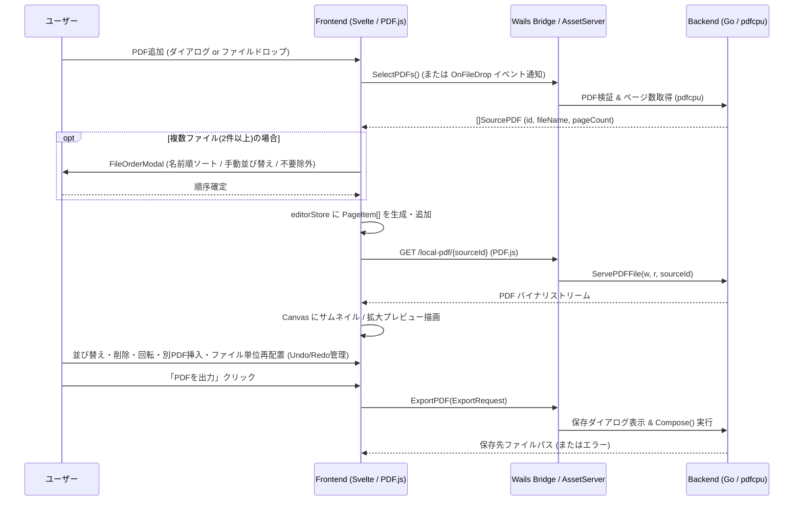

# 全体アーキテクチャ設計仕様書 (`docs/architecture.md`)

## 1. 背景と根拠

Linux および Windows の両環境で動作するPDF編集デスクトップアプリを構築するにあたり、以下の技術的課題がある。
- PDFの結合・ページ削除・回転をフロントエンドのJavaScriptライブラリのみで行うと、大容量PDFでメモリ消費が増大しやすい。
- 一方、GoバックエンドでPDFページの画像ラスタライズ（プレビュー生成）を行おうとすると、`MuPDF` (`go-fitz`) や `Poppler` などの CGo / 外部Cライブラリ依存が発生し、Windows/Linux向けのビルド・配布が複雑化する。

**解決策**:
- **PDFの構造操作（結合・ページ抽出・回転・保存）**: 純Goライブラリである `pdfcpu` を用いてバックエンドで実行する。
- **PDFのページプレビュー描画**: フロントエンドの `pdfjs-dist` (PDF.js) を用い、WebView内の `<canvas>` に直接描画する。
- **PDFバイナリ供給**: Wails の `AssetServer.Middleware` を活用し、登録されたローカルPDFファイルを `/local-pdf/{sourceId}` エンドポイントから `http.ServeFile` でストリーミング配信する。これにより Base64 エンコードによるメモリ膨張や IPC ボトルネックを回避する。

---

## 2. コンポーネント構成とデータフロー

---

## 3. インターフェース定義

### 3.1 Wails バインディング (`App` メソッド)
| メソッド名 | 引数 | 戻り値 | 役割 |
|---|---|---|---|
| `SelectPDFs()` | なし | `([]pdfcomposer.SourcePDF, error)` | OSのファイル選択ダイアログを開き、選択されたPDFを登録してメタデータを返す（ファイルドロップ時は `runtime.OnFileDrop` 経由で `pdf:files-dropped` イベントを発行） |
| `GetPDFBase64(sourceId)` | `sourceId string` | `(string, error)` | 登録済みPDFファイルのバイナリをBase64文字列として返し、カスタムURIスキーム（`wails://`）環境に依存せず `pdfjs-dist` へ `Uint8Array` を供給する |
| `ExportPDF(req)` | `req pdfcomposer.ExportRequest` | `(string, error)` | OSの保存ダイアログを開き（`req.OutputPath` が空の場合）、指定ページ順・回転角でPDFを合成出力する。キャンセル時は空文字列を返す |
| `ClearSources()` | なし | なし | バックエンドに登録された元PDFの管理情報（`sources` マップおよび `pathMap`）をすべてクリアし、内部IDカウンタを初期化する |

### 3.2 ローカルPDF配信エンドポイント
- **パス**: `GET /local-pdf/{sourceId}`
- **挙動**:
  - `sourceId` に対応する登録済みローカルPDFファイルパスを `Service.GetSourcePath(sourceId)` で解決し、`http.ServeFile` で返す。
  - 未登録の `sourceId` が指定された場合は `404 Not Found` を返す（任意のファイルパス読み取りを防ぐセキュリティ境界）。

---

## 4. 実装原則・エラーハンドリング
1. **パストラバーサル防止**: フロントエンドからは生のファイルパスではなく、バックエンドが発行したランダムまたは連番の `sourceId` のみで `/local-pdf/{sourceId}` にアクセスさせる。
2. **一時ファイルの確実な削除**: PDF合成時に作成する一時ディレクトリは `os.MkdirTemp` で生成し、`defer os.RemoveAll` によって成功・失敗を問わず必ず削除する。
3. **ユーザーキャンセルの扱い**: ファイル選択ダイアログや保存ダイアログでユーザーがキャンセルした場合はエラーではなく空結果（`nil` スライスまたは空文字列 `""`）として返し、UI側でエラートーストを出さない。
